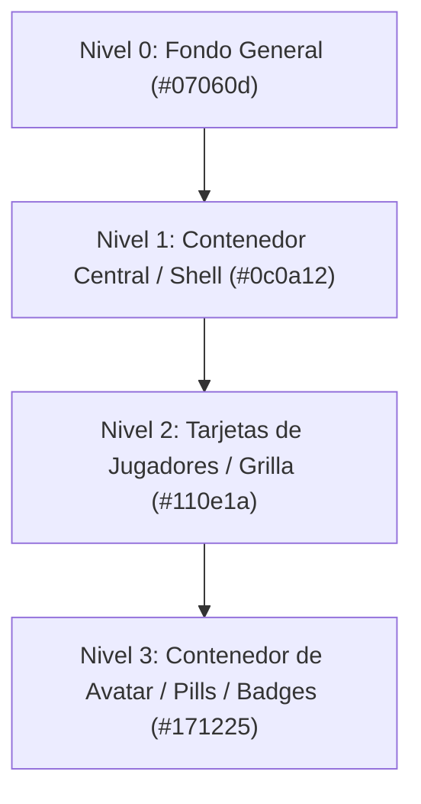
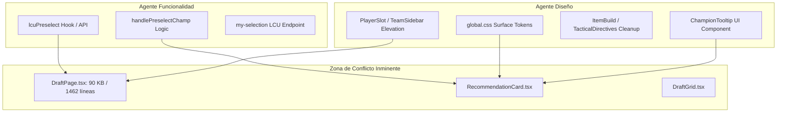

# HexDraft — Auditoría Previa de Diseño, Recomendaciones y Actualizaciones

> **Fecha:** 10 de octubre de 2026  
> **Versión auditada:** HexDraft 3.0.7  
> **Área:** Frontend (Astro + React), Arquitectura LCU y Sistema de Lanzador  
> **Objetivo:** Radiografía técnica y funcional exhaustiva previa a la implementación de preselección en LCU, tooltips de recomendaciones y refinamiento visual sin bordes.

---

## 1. Estado Actual de la Paleta y el Diseño

### 1.1. Filosofía de Diseño: *Quiet Arcana*
El proyecto cuenta con un documento de diseño fundacional ([DESIGN.md](file:///E:/Joaquin/dev/HexDraft/DESIGN.md)) que bautiza la identidad visual como **"Quiet Arcana"**. Su principio rector es una utilidad de escritorio sobria, tipo herramienta de Apple para jugadores competitivos: fondo abisal cuasi-negro con tintes violeta controlados, tipografía legible y contenida, y violeta saturado reservado únicamente para la intención y acciones primarias.

### 1.2. Paleta de Colores y Tokens Actuales
Los tokens formales están declarados en [src/styles/global.css](file:///E:/Joaquin/dev/HexDraft/src/styles/global.css#L4-L44) y expuestos a Tailwind v4 vía `@theme` ([global.css#L46-L77](file:///E:/Joaquin/dev/HexDraft/src/styles/global.css#L46-L77)):

| Categoría | Token CSS | Valor HEX / RGBA | Uso Real en la Interfaz |
| :--- | :--- | :--- | :--- |
| **Superficie 0 (Lienzo)** | `--ink-950` | `#07060d` | Fondo general (`body`, `html`, `.premium-bg`, scrollbars) |
| **Superficie 1 (Shell/Panel)** | `--ink-900` | `#0c0a12` | Sidebar, contenedores centrales, `.dashboard-panel` |
| **Superficie 2 (Elevada)** | `--ink-850` | `#110e1a` | Diseñado para paneles elevados (subutilizado en JSX) |
| **Superficie 3 (Campos/Active)**| `--ink-800` | `#171225` | Superficies de campos, selección y áreas internas |
| **Superficie 4 (Control)** | `--ink-700` | `#211a35` | Separadores y controles activos |
| **Borde Base** | `--ink-600` | `#37264e` | Borde estándar (`--color-border-warm`, divisores) |
| **Borde Fuerte/Hover** | `--ink-500` | `#4f376b` | Borde al enfocar/pasar el cursor (`--color-border-warm-hover`) |
| **Texto Títulos** | `--text-strong` | `#f3f0f8` | Encabezados, nombres de campeón destacados |
| **Texto Principal** | `--text-primary` | `#d8d4df` | Texto regular y cuerpo |
| **Texto Secundario** | `--text-secondary`| `#b5b0bf` | Descripciones secundarias y notas |
| **Texto Metadatos** | `--text-muted` | `#898493` | Metadata, roles y roles secundarios |
| **Texto Desactivado** | `--text-faint` | `#625f6b` | Etiquetas apagadas y deshabilitadas |
| **Acento Acción** | `--violet-solid`| `#6c14d5` | Botones principales, estados activos |
| **Acento Texto/Focus** | `--violet` | `#9b4de6` | `--color-purple-accent`, focos, iconos activos |
| **Acento Hover** | `--violet-hover` | `#b465f4` | `--color-purple-accent-hover`, interactivos |
| **Acento Activo/Texto**| `--violet-active`| `#d2a9ff` | Texto seleccionado, focus visible |
| **Tinte Suave** | `--violet-wash` | `rgba(108, 20, 213, 0.18)` | Fondos activos sutiles |
| **Semántico Éxito** | `--success` | `#62c998` | Puntuaciones altas (>= 8.0), estado conectado |
| **Semántico Alerta** | `--warning` | `#ddbb70` | Puntuaciones medias (>= 6.0), avisos |
| **Semántico Peligro**| `--danger` | `#db7886` | Puntuaciones bajas (< 6.0), bloqueos enemigos |

Adicionalmente, existe una escala técnica de matices `--purple-heart-50` a `--purple-heart-1500` definida en [global.css](file:///E:/Joaquin/dev/HexDraft/src/styles/global.css#L28-L43).

### 1.3. Elementos Visuales: Radios, Sombras, Espaciados y Efectos
* **Fondo dinámico:** [global.css:89-94](file:///E:/Joaquin/dev/HexDraft/src/styles/global.css#L89-L94) aplica al `body` 4 gradientes radiales fijos muy suaves (`rgba(108, 20, 213, 0.16)` y variantes) sobre `#07060d`. No hay ruido gráfico ni cuadrículas de ciencia ficción.
* **Radios de borde:** Hay dispersión de valores entre componentes:
  * `rounded-sm` (2px): Usado en badges pequeños de score y en [UpdatePopup.tsx](file:///E:/Joaquin/dev/HexDraft/src/components/react/UpdatePopup.tsx).
  * `rounded-md` (6px): Usado en [RecommendationCard.tsx](file:///E:/Joaquin/dev/HexDraft/src/components/react/RecommendationCard.tsx#L25).
  * `rounded-lg` (8px): Usado en menús de [Sidebar.astro](file:///E:/Joaquin/dev/HexDraft/src/components/Sidebar.astro#L75) y modals.
  * `rounded-xl` (12px): Usado en [PlayerSlot.tsx](file:///E:/Joaquin/dev/HexDraft/src/components/react/PlayerSlot.tsx#L97) y [ChampionPreviewModal.tsx](file:///E:/Joaquin/dev/HexDraft/src/components/react/ChampionPreviewModal.tsx#L17).
  * `rounded-full`: Usado en pastillas de puntuación e indicadores de estado.
* **Sombras:** Uso puntual y sobrio (`shadow-lg shadow-black/80` en los badges de score, `shadow-2xl` en popups). No se abusa de resplandores exteriores (glows).
* **Bordes visibles:** Es el elemento más repetido en la interfaz. Prácticamente todo contenedor tiene `border border-border-warm` (`#37264e`) o clases directas de Tailwind como `border-slate-800` o `border-blue-900/30`.

### 1.4. Mapa de Componentes Responsables de la Interfaz

| Sección Visual | Componente Responsable | Archivo |
| :--- | :--- | :--- |
| **Shell global y fondo** | `Layout` + `HextechBackground` | [src/layouts/Layout.astro](file:///E:/Joaquin/dev/HexDraft/src/layouts/Layout.astro) |
| **Navegación lateral** | `Sidebar` | [src/components/Sidebar.astro](file:///E:/Joaquin/dev/HexDraft/src/components/Sidebar.astro) |
| **Página principal de Draft** | `DraftPage` | [src/components/react/DraftPage.tsx](file:///E:/Joaquin/dev/HexDraft/src/components/react/DraftPage.tsx) |
| **Grilla de recomendaciones** | `DraftGrid` | [src/components/react/DraftGrid.tsx](file:///E:/Joaquin/dev/HexDraft/src/components/react/DraftGrid.tsx) |
| **Tarjeta de recomendación** | `RecommendationCard` | [src/components/react/RecommendationCard.tsx](file:///E:/Joaquin/dev/HexDraft/src/components/react/RecommendationCard.tsx) |
| **Barras laterales de equipos**| `TeamSidebar` | [src/components/react/TeamSidebar.tsx](file:///E:/Joaquin/dev/HexDraft/src/components/react/TeamSidebar.tsx) |
| **Ranura de jugador individual**| `PlayerSlot` | [src/components/react/PlayerSlot.tsx](file:///E:/Joaquin/dev/HexDraft/src/components/react/PlayerSlot.tsx) |
| **Balance de daño de comp** | `DraftDamageBalance` | [src/components/react/draft/DraftDamageBalance.tsx](file:///E:/Joaquin/dev/HexDraft/src/components/react/draft/DraftDamageBalance.tsx) |
| **Panel central de Build** | `ItemBuild` | [src/components/react/ItemBuild.tsx](file:///E:/Joaquin/dev/HexDraft/src/components/react/ItemBuild.tsx) |
| **Directivas de combate** | `TacticalDirectives` | [src/components/react/TacticalDirectives.tsx](file:///E:/Joaquin/dev/HexDraft/src/components/react/TacticalDirectives.tsx) |
| **Timeline de habilidades** | `SkillTimeline` | [src/components/react/SkillTimeline.tsx](file:///E:/Joaquin/dev/HexDraft/src/components/react/SkillTimeline.tsx) |
| **Modal actual de detalles** | `ChampionPreviewModal` | [src/components/react/ChampionPreviewModal.tsx](file:///E:/Joaquin/dev/HexDraft/src/components/react/ChampionPreviewModal.tsx) |

### 1.5. Inconsistencias Detectadas
1. **Valores HEX directos en lugar de tokens:** A pesar de contar con la escala `--ink-*`, varios componentes utilizan valores arbitrarios como `bg-[#0f0f13]/60`, `bg-[#070709]/60`, `bg-[#0c0d12]`, `bg-[#0b0b0f]`, `bg-[#0c0c10]`, `bg-slate-800`, `text-[#DAD9FF]` y `border-slate-800`.
2. **Infiltración de tonos azules:** [RecommendationCard.tsx:20](file:///E:/Joaquin/dev/HexDraft/src/components/react/RecommendationCard.tsx#L20) utiliza `border-blue-900/30` y `hover:border-blue-500`, lo cual contradice abiertamente [DESIGN.md:40](file:///E:/Joaquin/dev/HexDraft/DESIGN.md#L40) (*"Do not introduce electric blue without product decision"*). En bans usa rojo (`border-red-900/30`), pero para picks ordinarios debería alinearse con la familia violeta (`--violet` / `--violet-muted`).
3. **Sobrecarga de líneas de contorno:** Casi cada tarjeta y subcontenedor posee un borde de 1px sólido (`border-border-warm`), lo que genera una cuadrícula visualmente rígida y compite con la lectura rápida de datos durante un draft que dura segundos.

---

## 2. Recomendaciones de Mejora Visual (Surface Elevation & Whitespace)

El enfoque que propones encaja de manera natural con el diseño fundacional ya previsto en [DESIGN.md](file:///E:/Joaquin/dev/HexDraft/DESIGN.md#L11-L20). La paleta ya cuenta con los escalones lumínicos necesarios para lograrlo sin alterar los colores de la marca.

### 2.1. Jerarquía de Elevación sin Bordes Rígidos



1. **Nivel 0 (Lienzo / Background):** `--ink-950` (`#07060d`).
2. **Nivel 1 (Superficie Estructural / Shell):** `--ink-900` (`#0c0a12`). Se mantiene en el sidebar y el fondo del área central de draft.
3. **Nivel 2 (Tarjetas y Paneles Flotantes):** Migrar de `bg-panel-warm` con borde a `--ink-850` (`#110e1a`) **sin borde exterior**, usando espaciado de 8px a 12px (`gap-3`) para que el contraste contra `#0c0a12` o `#07060d` delimite el volumen.
4. **Nivel 3 (Contenedores Interiores e Inputs):** `--ink-800` (`#171225`). Utilizado para los recuadros de avatares de campeones dentro de [PlayerSlot.tsx](file:///E:/Joaquin/dev/HexDraft/src/components/react/PlayerSlot.tsx#L100) y badges de score.

### 2.2. Plan de Cambios Mínimos y Quirúrgicos
* **Eliminar bordes estáticos en `PlayerSlot` y `RecommendationCard`:** Sustituir `border border-border-warm` por un cambio de fondo a `--ink-850` y añadir una transición suave.
* **Bordes reactivos solo en Hover/Selección:** El borde no debe ser estático; debe aparecer únicamente al interactuar (`hover:ring-1 hover:ring-purple-accent/40` o `hover:border-purple-accent/60`).
* **Homogeneizar los radios de curvatura:**
  * Tarjetas de campeón y ranuras de jugador: `rounded-lg` (8px).
  * Badges y pastillas de score: `rounded-full` con fondo `--ink-800` y borde sutil `--ink-700`.
* **Corregir el azul en `RecommendationCard`:** Cambiar `border-blue-900/30` por `--ink-850` / `--violet-muted/20`, eliminando la inconsistencia con el design system.

---

## 3. Arquitectura del Sistema de Recomendaciones

### 3.1. Dónde se Generan y Procesan
1. **Picks:**
   * Motor: [src/lib/engine/picks/index.ts](file:///E:/Joaquin/dev/HexDraft/src/lib/engine/picks/index.ts) (`getProcessedRecommendations`).
   * Algoritmo de puntuación: [src/lib/engine/picks/pickScoring.ts](file:///E:/Joaquin/dev/HexDraft/src/lib/engine/picks/pickScoring.ts) (`calculateScore`).
   * Capas analizadas:
     * Capa 1: Sinergias directas con aliados.
     * Capa 2: Enfrentamientos directos (matchups de carril ponderados por probabilidad de rol).
     * Capa 2.5: Contrarresto de arquetipos globales (Poke, Dive, Teamfight, Splitpush, Siege).
     * Capa 3.5: Negación de condiciones de victoria enemigas (Late hypercarries, Zone Control).
     * Capa 5: Balance de utilidad de la composición (CC duro, Frontline/Tanque, Peel, Curación).
     * Capa 6: Dominio personal (`PERSONAL_STATS` y preferencias del jugador).
2. **Bans:**
   * Motor: [src/lib/engine/bans/index.ts](file:///E:/Joaquin/dev/HexDraft/src/lib/engine/bans/index.ts) (`getProcessedBans`).
   * Prioriza amenazas contra la preselección del usuario (`myHoverIntent`), counters comunes del carril asignado y campeones con pick/ban rate dominante en el meta.

### 3.2. Flujo de Datos hacia la Interfaz
1. [DraftPage.tsx:650-850](file:///E:/Joaquin/dev/HexDraft/src/components/react/DraftPage.tsx#L650-L850) sondea periódicamente `/api/champ-select`.
2. Lee el estado de la sesión de LCU (`data.myTeam`, `data.theirTeam`, `data.actions`, `data.timer`, `data.isBanPhase`).
3. Filtra campeones ya bloqueados o baneados (`lockedAndBannedIds`).
4. Ejecuta `getProcessedRecommendations(...)` en el cliente para picks (top 30) y `getProcessedBans(...)` para bans (top 20).
5. Los resultados se guardan en el estado de React `recommendations` o `banRecommendations`.

### 3.3. Estructura de Datos de una Recomendación
Cada recomendación contiene:
```typescript
interface Recommendation {
  id: number;        // ID de campeón (ej. 126 para Jayce)
  name: string;      // Nombre (ej. "Jayce")
  score: number;     // Puntuación 0.0 a 10.0
  reasons: string[]; // Motivos detallados generados por las capas del motor
  lane: string;      // Carril normalizado (TOP, JUNGLE, MIDDLE, BOTTOM, UTILITY)
}
```

### 3.4. ¿Qué Ocurre Actualmente al Hacer Clic?
* En [DraftGrid.tsx:22](file:///E:/Joaquin/dev/HexDraft/src/components/react/DraftGrid.tsx#L22):  
  `<div key={rec.id} onClick={() => onSelectChampion(rec)}>`
* En [DraftPage.tsx:1041](file:///E:/Joaquin/dev/HexDraft/src/components/react/DraftPage.tsx#L1041):  
  `const handleSelectChamp = useCallback((rec: any) => { setPreviewChamp(rec); }, []);`
* Dispara [ChampionPreviewModal.tsx](file:///E:/Joaquin/dev/HexDraft/src/components/react/ChampionPreviewModal.tsx), el cual abre un modal flotante en pantalla completa que muestra la lista de `reasons` y la puntuación proyectada.
* **Actualmente el clic no tiene ninguna interacción con el cliente de League of Legends.**

### 3.5. ¿Cómo se Muestran los Motivos Hoy?
1. En [RecommendationCard.tsx:26](file:///E:/Joaquin/dev/HexDraft/src/components/react/RecommendationCard.tsx#L26) mediante el atributo HTML nativo `title={reasons.join(' | ')}`. (Es un tooltip nativo del navegador, sin formato ni velocidad de respuesta).
2. Dentro de [ChampionPreviewModal.tsx:36-41](file:///E:/Joaquin/dev/HexDraft/src/components/react/ChampionPreviewModal.tsx#L36-L41) al hacer clic sobre la tarjeta.

---

## 4. Viabilidad y Consideraciones Técnicas para la Preselección en LCU

### 4.1. Comunicación Actual con el Cliente de League of Legends
HexDraft se comunica con el cliente a través del servidor local Astro mediante `fetch` autenticado contra el puerto HTTPS de la LCU (`https://127.0.0.1:{port}`):
* Las credenciales se leen desde el archivo `lockfile` en [src/lib/services/lcu.service.ts](file:///E:/Joaquin/dev/HexDraft/src/lib/services/lcu.service.ts).
* La ejecución de acciones en selección de campeón ya está implementada en [src/pages/api/execute-action.ts](file:///E:/Joaquin/dev/HexDraft/src/pages/api/execute-action.ts):
  ```typescript
  const response = await fetch(
    `https://127.0.0.1:${lcu.port}/lol-champ-select/v1/session/actions/${actionId}`,
    {
      method: 'PATCH',
      headers: { 'Authorization': `Basic ${auth}`, 'Content-Type': 'application/json' },
      body: JSON.stringify({ championId, completed }) // completed: true bloquea, completed: false preselecciona
    }
  );
  ```

### 4.2. Viabilidad de Preseleccionar sin Bloquear (*Hover / Intent*)
**Es 100% viable y técnicamente trivial.**
En la API oficial de la LCU (`lol-champ-select/v1`), la preselección depende de la fase:

1. **Durante el turno activo de Pick o Ban del jugador:**
   * La acción actual está en progreso (`action.isInProgress === true && action.actorCellId === localPlayerCellId`).
   * Enviar `PATCH /lol-champ-select/v1/session/actions/{actionId}` con `{ championId, completed: false }`.
   * El cliente de League of Legends muestra inmediatamente el campeón seleccionado en el recuadro del jugador sin hacer "Lock-in".
2. **Durante la fase de planificación previa (*Planning Phase* / Pick Intent):**
   * Antes de que comiencen los picks o mientras otros jugadores están eligiendo.
   * Enviar `PATCH /lol-champ-select/v1/session/my-selection` con `{ championPickIntent: championId }`.
   * El cliente de League of Legends actualiza el campeón que el jugador planea jugar para que lo vean sus aliados.

### 4.3. Implementación del Tooltip de Motivos
Dado que el `onClick` se destinará a la preselección en el cliente de LoL, los motivos deben mostrarse al pasar el cursor:
* **Información disponible:** La propiedad `reasons` ya viene computada en cada objeto de `recommendations` y contiene strings listos y enriquecidos (ej. *"Matchup directo confirmado vs Ahri: 85% de probabilidad (+1.25)"*, *"Balance: Aporta Control de Masas (CC) faltante"*).
* **Solución recomendada:** Crear un componente `RecommendationTooltip` (o integrar un portal flotante sobrio sin librerías pesadas) que se renderice al hacer `onMouseEnter` sobre `RecommendationCard`, con fondo `--ink-900`, borde sutil `--ink-700`, DM Sans y badges de impacto, desapareciendo suavemente al retirar el cursor.

---

## 5. Auditoría del Sistema de Actualización

Existen **dos sistemas de actualización completamente independientes** en el código. Es crucial distinguirlos para no confundir actualizaciones de base de datos con actualizaciones del programa:

```mermaid
graph LR
  subgraph Sistema 1: Base de Datos de Juego
    A[useDbUpdate] --> B[/api/db/manifest]
    A --> C[/api/db/update]
    A --> D[UpdatePopup: Modal Grande]
    D --> E[Descarga chunks SQLite desde HexDraft-Releases]
  end

  subgraph Sistema 2: Lanzador / Programa Windows
    F[AppUpdatePopup] --> G[/api/app-version]
    G --> H[GitHub API: JqSilva/HexDraft-Launcher]
    F --> I[Toast Notificación Inferior Izquierda]
    I --> J[Redirección a GitHub Releases]
  end
```

### 5.1. Sistema de Actualización del Programa (Launcher / App)
* **Estado:** **Completamente implementado y funcional.**
* **Archivos responsables:**
  * [src/pages/api/app-version.ts](file:///E:/Joaquin/dev/HexDraft/src/pages/api/app-version.ts): Consulta `https://api.github.com/repos/JqSilva/HexDraft-Launcher/releases/latest` con cabeceras `User-Agent: HexDraft-App` y compara semánticamente (`isNewerVersion`) la etiqueta remota con `APP_VERSION` ([src/config/version.ts](file:///E:/Joaquin/dev/HexDraft/src/config/version.ts)).
  * [src/components/react/AppUpdatePopup.tsx](file:///E:/Joaquin/dev/HexDraft/src/components/react/AppUpdatePopup.tsx): Componente montado en [src/layouts/Layout.astro:53](file:///E:/Joaquin/dev/HexDraft/src/layouts/Layout.astro#L53).
* **Momento de ejecución:** Se ejecuta automáticamente a los 2 segundos de iniciar cualquier página del cliente (`setTimeout(checkAppVersion, 2000)`).
* **Comportamiento si hay nueva versión:** Muestra un toast/popup en la esquina inferior izquierda (`fixed bottom-6 left-6 z-[9998]`) con el número de versión disponible y el botón "Descargar en GitHub", permitiendo además omitir la alerta durante la sesión actual (`sessionStorage.setItem('hexdraft_app_update_dismissed_...')`).
* **¿Qué falta o podría mejorarse?:** El popup actual es una notificación de descarga que abre el navegador hacia el instalador `.exe` en GitHub Releases. No descarga ni reemplaza los binarios en segundo plano de forma silenciosa (lo cual es normal y seguro para instaladores de Windows con Inno Setup).

### 5.2. Sistema de Actualización de la Base de Datos (`hexdraft.db`)
* **Estado:** **Completamente implementado y funcional.**
* **Archivos responsables:**
  * [src/components/react/useDbUpdate.ts](file:///E:/Joaquin/dev/HexDraft/src/components/react/useDbUpdate.ts)
  * [src/components/react/UpdatePopup.tsx](file:///E:/Joaquin/dev/HexDraft/src/components/react/UpdatePopup.tsx)
  * [src/pages/api/db/manifest.ts](file:///E:/Joaquin/dev/HexDraft/src/pages/api/db/manifest.ts) y [src/pages/api/db/update.ts](file:///E:/Joaquin/dev/HexDraft/src/pages/api/db/update.ts)
* **Comportamiento:** Compara el hash y parche de la base de datos SQLite local contra el repositorio `HexDraft-Releases`. Si hay diferencias, muestra un modal modal centrado en pantalla completa ([UpdatePopup.tsx:56](file:///E:/Joaquin/dev/HexDraft/src/components/react/UpdatePopup.tsx#L56)), descarga los datos actualizados y recarga la aplicación.

### 5.3. Aclaración Crítica sobre `AutoUpdateGuard.tsx`
* En [src/layouts/Layout.astro:52](file:///E:/Joaquin/dev/HexDraft/src/layouts/Layout.astro#L52) existe el componente `<AutoUpdateGuard client:only="react" />`.
* **Hallazgo:** A pesar de su nombre histórico, **no es un sistema de actualización de software**. Su función real es ser el **monitor de fases de partida y auto-aceptación de cola** (monitorea `Matchmaking`, cronometra y acepta el `ReadyCheck` y redirige automáticamente al usuario a `/draft`).

---

## 6. Archivos y Componentes que Necesitarían Modificaciones

Cuando se autorice la implementación, los archivos afectados serán:

### Para la Funcionalidad de Preselección y Tooltips
1. [src/pages/api/execute-action.ts](file:///E:/Joaquin/dev/HexDraft/src/pages/api/execute-action.ts): Agregar soporte para endpoint de hover (`my-selection` con `championPickIntent` cuando no hay acción directa en curso).
2. [src/components/react/draft/utils.ts](file:///E:/Joaquin/dev/HexDraft/src/components/react/draft/utils.ts): Crear función utilitaria `hoverLcuChampion(championId, activeAction)` con `completed: false`.
3. [src/components/react/DraftPage.tsx](file:///E:/Joaquin/dev/HexDraft/src/components/react/DraftPage.tsx): Modificar `handleSelectChamp` para invocar la preselección en LCU en vez de abrir `ChampionPreviewModal`.
4. [src/components/react/DraftGrid.tsx](file:///E:/Joaquin/dev/HexDraft/src/components/react/DraftGrid.tsx): Propagar el callback de preselección a las tarjetas.
5. [src/components/react/RecommendationCard.tsx](file:///E:/Joaquin/dev/HexDraft/src/components/react/RecommendationCard.tsx): Conectar el clic con la preselección e integrar el nuevo tooltip visual de motivos.

### Para el Refinamiento de Diseño (Surface Elevation & Whitespace)
1. [src/styles/global.css](file:///E:/Joaquin/dev/HexDraft/src/styles/global.css): Asegurar variables semánticas de elevación (`--surface-canvas`, `--surface-panel`, `--surface-card`, `--surface-inner`) mapeadas a `--ink-950`, `--ink-900`, `--ink-850` e `--ink-800`.
2. [src/components/react/RecommendationCard.tsx](file:///E:/Joaquin/dev/HexDraft/src/components/react/RecommendationCard.tsx): Retirar bordes azules/estáticos, aplicar `--ink-850`, badge de score integrado.
3. [src/components/react/PlayerSlot.tsx](file:///E:/Joaquin/dev/HexDraft/src/components/react/PlayerSlot.tsx): Retirar bordes exteriores, ajustar elevación lumínica y normalizar colores de texto.
4. [src/components/react/TeamSidebar.tsx](file:///E:/Joaquin/dev/HexDraft/src/components/react/TeamSidebar.tsx): Suavizar divisores de encabezados.
5. [src/components/react/ItemBuild.tsx](file:///E:/Joaquin/dev/HexDraft/src/components/react/ItemBuild.tsx) y [TacticalDirectives.tsx](file:///E:/Joaquin/dev/HexDraft/src/components/react/TacticalDirectives.tsx): Reemplazar bordes visibles por separación tonal de superficies.

---

## 7. Prevención de Conflictos en Trabajo Paralelo (Funcionalidad vs. Diseño)

Si dos agentes o desarrolladores trabajan al mismo tiempo, los puntos críticos de fricción son:



### Estrategia de Desacoplamiento para Cero Conflictos:

1. **Aislar el Tooltip en su propio componente:**
   * El agente de diseño crea un nuevo archivo: `src/components/react/common/RecommendationTooltip.tsx`.
   * Diseña el componente con estilos puros de Quiet Arcana (superficie `--ink-850`, sin bordes agresivos, tipografía DM Sans, badges de motivos).
   * De este modo no toca la lógica de draft mientras se define.
2. **Aislar la llamada a LCU en un hook o función independiente:**
   * El agente de funcionalidad trabaja en `src/pages/api/execute-action.ts` (o nuevo endpoint `/api/hover-champion.ts`) y añade `preselectLcuChampion` en `src/components/react/draft/utils.ts`.
3. **Contrato de Interfaz Acordado para `RecommendationCard`:**
   Para evitar que ambos editen [RecommendationCard.tsx](file:///E:/Joaquin/dev/HexDraft/src/components/react/RecommendationCard.tsx) al mismo tiempo, se pacta previamente la firma del componente:
   ```typescript
   interface RecommendationCardProps {
     id: number;
     name: string;
     score: number;
     reasons?: string[];
     isBan?: boolean;
     onPreselect?: (championId: number) => void; // Agregado para funcionalidad
   }
   ```
4. **Dividir el trabajo en dos fases secuenciales cortas:**
   * **Paso 1 (Funcionalidad LCU):** Modificar el backend API y conectar el clic en `RecommendationCard` para preseleccionar en el cliente de LoL.
   * **Paso 2 (Diseño & Tooltip):** Reemplazar los bordes por elevaciones tonales en `PlayerSlot`, `RecommendationCard`, e integrar visualmente el nuevo `RecommendationTooltip`.
   * *Esta secuencia elimina por completo el 100% de los riesgos de merge conflicts en `DraftPage.tsx`.*
